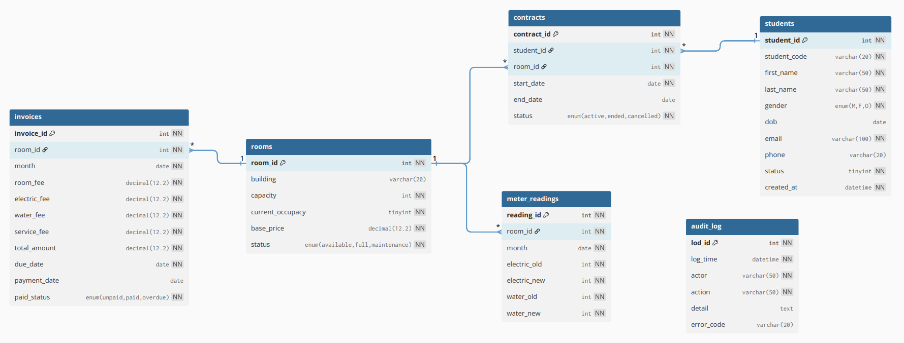

# Dormitory Management System (DBMS Optimization)

[](https://www.mysql.com/)
[](https://www.docker.com/)
[](https://www.python.org/)
[](https://streamlit.io/)
[](https://k6.io/)

# 1. Project Overview (English)
This project focuses on building and optimizing a relational database for a Dormitory/Apartment Management System. Moving beyond basic CRUD operations, this system demonstrates advanced database techniques to handle real-world concurrency, automated batch processing, and high-traffic read operations.

## Core Objectives
* **ACID Transactions (`sp_transfer_room`):** Ensures safe student room transfers with automatic `ROLLBACK` mechanisms to prevent overbooking and maintain data integrity.
* **Automated Batch Processing:** Utilizes Stored Procedures and Event Schedulers to automatically calculate and generate monthly utility and room invoices.
* **High Availability & Performance:** Implements a **Master-Slave Replication** architecture for Read/Write splitting (writes to Master, reads from Slave), coupled with strategic Indexing (`EXPLAIN` benchmarked) to optimize heavy queries like overdue debt reporting.
* **Monthly Contract Boundary:** All contract changes (room transfers, terminations, cancellations) take effect only at the end of the month. During the month, students are not allowed to change rooms immediately; all changes will be applied on the month-end closing date (after invoices are generated).
## Tech Stack
* **DBMS:** MySQL 8 (InnoDB Engine)
* **Infrastructure:** Docker & Docker Compose (Master/Slave nodes)
* **Backend & Data:** Python (PyMySQL, Faker for generating 5k+ realistic records)
* **Frontend:** Streamlit (Interactive UI for Demo & Data Viz)

## Project Structure
```text
.
├── backend/                # Backend source code (Python, DB handling, API)
│   ├── db_helper.py
│   └── main.py
├── dashboard/              # User interface (Streamlit UI)
│   ├── app.py
│   ├── Dockerfile
│   ├── roles.py
│   └── lang/               # Multilingual support for dashboard
│       ├── en.json
│       └── vi.json
├── database/               # Database definitions, migrations, seed data
│   ├── 01-schema.sql
│   ├── 02-views.sql
│   ├── 03-procedures.sql
│   ├── 05-replication.sql
│   ├── 06-events.sql
│   ├── 07-triggers.sql
│   ├── 99-seed-data.sql
│   └── migrations/
│       ├── 2026-03-25-01-sample-file.sql
│       └── ...
├── dockerfiles/            # Dockerfiles for system components
│   ├── Dockerfile.master
│   └── Dockerfile.slave
├── mysql-config/           # MySQL configuration for master/slave
│   ├── master.cnf
│   └── slave.cnf
├── scripts/                # Supporting scripts (data generation, benchmarking, ...)
│   ├── benchmark.js
|   ├── Dockerfile.k6
│   ├── generate_data.py
│   └── run_gen.bat
├── results/                # Benchmark results, performance reports
├── imgs/                   # Illustrative images (ERD, diagrams, ...)
├── docs/                   # Documentation and specifications
│   ├── benchmark-scenario.md
│   ├── commit-guide.md
│   ├── data-dictionary.md
│   ├── test-cases.md
│   └── workflow-guide.md
├── env.example             # Example environment file
├── docker-compose.yml      # Docker Compose orchestration file
├── requirements.txt        # Required Python libraries
└── README.md               # Project introduction documentation
```

## Database Design


### Table Schema
The project designs a minimum of 6 tables:
- `students`
- `rooms`
- `contracts`
- `meter_readings`
- `invoices`
- `audit_log`

### Business Rules

- BR-01: A `room` must not have `current_occupancy > capacity`  
- BR-02: A `student` has **at most 1** `contract` with `status='active'` at a given time  
- BR-03: A `room` can have multiple contracts over time, but cannot exceed capacity at the same time  
- BR-04: Each room has a maximum of 1 `meter_readings` record per month  
- BR-05: Each room has a maximum of 1 `invoice` per month (or 1 invoice/contract/month if chosen to attach by contract)
- BR-06: Contract changes only take effect at the end of the month  
  - Students are not allowed to "change rooms mid-month".  
  - All status changes to `contracts.status` (active → ended/cancelled) and all new contracts (`INSERT`) are considered effective on the last day (LAST_DAY) of the current month or the configured month.
- BR-07: Room allocation rule: Male students are allocated to rooms with even numbers; Female students are allocated to rooms with odd numbers.
- BR-08: When a student with status 0 (inactive) is successfully allocated a room, the system automatically changes the status to 1 (active) and creates a new contract.

> Note: BR-02 is difficult to strictly enforce in MySQL using a UNIQUE constraint if using ENUM/status.
> Decision: enforce using **procedure/transaction** + supporting index.

### Design Details
See at: 
[Data Dictionary](docs/data-dictionary.md)

# 2. Setup Instruction
## Part 1: Docker Configuration
**Prerequisites**
- Docker Desktop: Installed and Running.
- Git: Installed.
- Environment Variables: Create a .env file based on the .env.example template.

**Run Commands**

Step 1: Clean up the old environment
```bash
docker-compose down -v
```

Step 2: Start the Docker system
```bash
docker-compose up -d --build
```

Step 3: Check status
```bash
docker ps
```

Step 4: Activate replication
```bash
docker exec -it mysql-slave mysql -u root -p<root_password> -e "CHANGE MASTER TO MASTER_HOST='mysql-master', MASTER_USER='repl_user', MASTER_PASSWORD='Repl_Pass@123', MASTER_AUTO_POSITION=1; START SLAVE;"
```
Note: Replace root_password with the password configured in the .env file.

If the system reports an error related to running replication threads:
```text
ERROR 3081 (HY000) at line 1: This operation cannot be performed with running replication threads; run STOP REPLICA FOR CHANNEL first
```

Run the following command:
```bash
docker exec -it mysql-slave mysql -u root -p<root_password> -e "STOP REPLICA; CHANGE MASTER TO MASTER_HOST='mysql-master', MASTER_USER='repl_user', MASTER_PASSWORD='Repl_Pass@123', MASTER_AUTO_POSITION=1; START REPLICA;"
```

Step 5: Verify configuration results
```bash
docker exec -it mysql-slave mysql -u root -p<root_password> -e "SHOW REPLICA STATUS\G"
```

Success status when:
```text
Replica_IO_Running: Yes
Replica_SQL_Running: Yes
```

**Start/Stop containers temporarily**


```bash
docker-compose start # Restart
docker-compose stop # Pause
```

## Part 2: Data Generation via Faker
**Sample Quantity**

Run the code in the following section and enter the following quantities (optional):
- 5000 students
- 1000 rooms
- 5000 contracts

**Run Commands**

Run the following script to initialize data into the database via the Streamlit container:

```bash
docker-compose run --rm streamlit python -m scripts.generate_data
```

## Part 3: User Interface Operations
**Run Commands**

Open any web browser and access the following address to perform operations on the user interface (such as switching rooms, managing rooms, waiting list, ...)

```bash
http://localhost:18501/
```

## Part 4: Performance Evaluation
**Run Commands**

Step 1: Build image from Dockerfile.k6
```bash
docker build -f scripts/Dockerfile.k6 -t k6-sql .
```

Step 2: Create the results directory to store output (if it does not exist)
```bash
mkdir results
```

Step 3: Run the benchmark file
```bash
docker run --rm ` -v "${PWD}:/app" -w /app ` -e MASTER_DB="root:<insert_password>@tcp(host.docker.internal:13306)/dormitory_management" ` -e SLAVE_DB="root:<insert_password>@tcp(host.docker.internal:13307)/dormitory_management" ` k6-sql run scripts/benchmark.js
```

Note: Replace `<insert_password>` with the password configured in the .env file.

Step 4: Export raw CSV file (optional)
```bash
docker run --rm -v "${PWD}:/app" -w /app `
  	-e MASTER_DB="root:123456@tcp(host.docker.internal:13306)/dormitory_management" `
-e SLAVE_DB="root:123456@tcp(host.docker.internal:13307)/dormitory_management" `
k6-sql run --out csv=results/raw_metrics.csv scripts/benchmark.js
```

---

# 1. Tổng quan dự án (Vietnamese)
Dự án này tập trung vào việc xây dựng và tối ưu hóa cơ sở dữ liệu quan hệ cho Hệ thống Quản lý Ký túc xá/Chung cư. Thay vì chỉ dừng lại ở các thao tác truy vấn cơ bản, hệ thống ứng dụng các kỹ thuật CSDL nâng cao để giải quyết bài toán thực tế về tranh chấp dữ liệu, tự động hóa chốt công nợ và chịu tải cao.

## Mục tiêu cốt lõi
* **Transaction & ACID (`sp_transfer_room`):** Xử lý nghiệp vụ chuyển phòng an toàn, sử dụng cơ chế khóa dòng (Row-level lock) và tự động `ROLLBACK` khi phòng đầy để tránh tình trạng "ngủ ngoài đường" trên hệ thống.
* **Tự động hóa hóa đơn:** Sử dụng Stored Procedure kết hợp Event Scheduler để tính toán và chốt hóa đơn điện/nước/phòng hàng loạt một cách tự động mỗi cuối tháng.
* **Hiệu năng & Khả năng mở rộng:** Triển khai kiến trúc **Master-Slave Replication** để tách biệt luồng Đọc/Ghi (Ghi vào Master, Đọc từ Slave). Kết hợp đánh Index chiến lược và dùng lệnh `EXPLAIN` để tối ưu hóa các truy vấn nặng như xem danh sách nợ quá hạn.
* **Ràng buộc cuối tháng:** Sinh viên không được chuyển phòng giữa tháng. Mọi thay đổi hợp đồng (chuyển phòng, kết thúc hợp đồng, hủy) chỉ có hiệu lực vào ngày cuối tháng sau khi hệ thống chốt toàn bộ hóa đơn tháng đó.
## Công nghệ sử dụng
* **Hệ quản trị CSDL:** MySQL 8 (Engine InnoDB)
* **Hạ tầng:** Docker & Docker Compose (Triển khai cụm Master/Slave)
* **Backend & Dữ liệu:** Python (PyMySQL, thư viện Faker dùng để bơm hơn 5000+ bản ghi chuẩn nghiệp vụ)
* **Giao diện (UI):** Streamlit (Tương tác trực quan và Demo)

## Cấu trúc dự án
```text
.
├── backend/                # Mã nguồn backend (Python, xử lý DB, API)
│   ├── db_helper.py
│   └── main.py
├── dashboard/              # Giao diện người dùng (Streamlit UI)
│   ├── app.py
│   ├── Dockerfile
│   ├── roles.py
│   └── lang/               # Đa ngôn ngữ cho dashboard
│       ├── en.json
│       └── vi.json
├── database/               # Định nghĩa CSDL, migration, seed data
│   ├── 01-schema.sql
│   ├── 02-views.sql
│   ├── 03-procedures.sql
│   ├── 05-replication.sql
│   ├── 06-events.sql
│   ├── 07-triggers.sql
│   ├── 99-seed-data.sql
│   └── migrations/
│       ├── 2026-03-25-01-sample-file.sql
│       └── ...
├── dockerfiles/            # Dockerfile cho các thành phần hệ thống
│   ├── Dockerfile.master
│   └── Dockerfile.slave
├── mysql-config/           # Cấu hình MySQL cho master/slave
│   ├── master.cnf
│   └── slave.cnf
├── scripts/                # Script hỗ trợ (tạo dữ liệu, benchmark, ...)
│   ├── benchmark.js
|   ├── Dockerfile.k6
│   ├── generate_data.py
│   └── run_gen.bat
├── results/                # Kết quả benchmark, báo cáo hiệu năng
├── imgs/                   # Hình ảnh minh họa (ERD, diagram, ...)
├── docs/                   # Tài liệu hướng dẫn, đặc tả
│   ├── benchmark-scenario.md
│   ├── commit-guide.md
│   ├── data-dictionary.md
│   ├── test-cases.md
│   └── workflow-guide.md
├── env.example             # File môi trường mẫu
├── docker-compose.yml      # Docker Compose orchestration file
├── requirements.txt        # Thư viện Python cần cài đặt
└── README.md               # Tài liệu giới thiệu dự án
```

## Thiết kế Cơ sở Dữ liệu


### Sơ đồ bảng
Dự án thiết kế 6 bảng tối thiểu:
- `students`
- `rooms`
- `contracts`
- `meter_readings`
- `invoices`
- `audit_log`

### Quy tắc nghiệp vụ

- BR-01: Một `room` không được có `current_occupancy > capacity`  
- BR-02: Một `student` **tối đa 1** `contract` có `status='active'` tại một thời điểm  
- BR-03: Một `room` có thể có nhiều hợp đồng theo thời gian, nhưng cùng thời điểm không vượt capacity  
- BR-04: Mỗi phòng mỗi tháng chỉ có tối đa 1 bản ghi `meter_readings`  
- BR-05: Mỗi phòng mỗi tháng chỉ có tối đa 1 `invoice` (hoặc 1 invoice/contract/tháng nếu chọn gắn theo contract)
- BR-06: Thay đổi hợp đồng chỉ có hiệu lực cuối tháng  
  - Sinh viên không được phép "chuyển phòng giữa tháng".  
  - Mọi thay đổi trạng thái `contracts.status` (active → ended/cancelled) và mọi hợp đồng mới (`INSERT`) đều được coi là có hiệu lực tại ngày cuối tháng (LAST_DAY) của tháng hiện tại hoặc tháng được cấu hình.
- BR-07: Quy tắc xếp phòng: Sinh viên Nam được xếp vào các phòng mang số chẵn; Sinh viên Nữ được xếp vào các phòng mang số lẻ.
- BR-08: Khi sinh viên có trạng thái 0 (inactive) được xếp phòng thành công, hệ thống tự động đổi trạng thái sang 1 (active) và tạo hợp đồng mới.

> Lưu ý: BR-02 trong MySQL khó enforce tuyệt đối bằng UNIQUE constraint nếu dùng ENUM/status.
> Quyết định: enforce bằng **procedure/transaction** + index hỗ trợ.

### Chi tiết thiết kế
Xem tại: 
[Data Dictionary](docs/data-dictionary.md)

# 2.Hướng dẫn khởi chạy
## Phần 1: Cấu hình Docker
**Chuẩn bị môi trường**
- Docker Desktop: Đã cài đặt và đang hoạt động (Running).
- Git: Đã được cài đặt.
- Biến môi trường: Tạo file .env dựa trên file mẫu .env.example.

**Chạy lệnh**

Bước 1: Dọn dẹp môi trường cũ
```bash
docker-compose down -v
```

Bước 2: Khởi động hệ thống Docker
```bash
docker-compose up -d --build
```

Bước 3: Kiểm tra trạng thái
```bash
docker ps
```

Bước 4: Kích hoạt replication
```bash
docker exec -it mysql-slave mysql -u root -p<root_password> -e "CHANGE MASTER TO MASTER_HOST='mysql-master', MASTER_USER='repl_user', MASTER_PASSWORD='Repl_Pass@123', MASTER_AUTO_POSITION=1; START SLAVE;"
```
Lưu ý: Thay `<root_password>` bằng password đã thiết lập trong file .env.

Nếu hệ thống báo lỗi liên quan đến running replication threads:
```text
ERROR 3081 (HY000) at line 1: This operation cannot be performed with running replication threads; run STOP REPLICA FOR CHANNEL first
```

Hãy chạy lệnh sau:
```bash
docker exec -it mysql-slave mysql -u root -p<root_password> -e "STOP REPLICA; CHANGE MASTER TO MASTER_HOST='mysql-master', MASTER_USER='repl_user', MASTER_PASSWORD='Repl_Pass@123', MASTER_AUTO_POSITION=1; START REPLICA;"
```

Bước 5: Kiểm tra kết quả cấu hình
```bash
docker exec -it mysql-slave mysql -u root -p<root_password> -e "SHOW REPLICA STATUS\G"
```

Trạng thái thành công khi:
```text
Replica_IO_Running: Yes
Replica_SQL_Running: Yes
```

**Bật/tắt tạm thời container**


```bash
docker-compose start # Khởi động lại
docker-compose stop # Tạm dừng
```

## Phần 2: Sinh dữ liệu qua Faker
**Số lượng mẫu**

Chạy đoạn code ở phần sau rồi nhập số lượng mẫu sau đây (tùy chọn):
- 5000 students
- 1000 rooms
- 5000 contracts

**Chạy lệnh**

Chạy script sau để khởi tạo dữ liệu vào database qua Streamlit container:

```bash
docker-compose run --rm streamlit python -m scripts.generate_data
```

## Phần 3: Thao tác giao diện người dùng
**Chạy lệnh**

Mở trình duyệt web bất kỳ, truy cập vào địa chỉ sau để thực hiện các thao tác trên giao diện người dùng (như chuyển phòng, quản lý phòng, danh sách chờ,...)

```bash
http://localhost:18501/
```

## Phần 4: Đánh giá hiệu năng
**Chạy lệnh**

Bước 1: Build image trong file Dockerfile.k6
```bash
docker build -f scripts/Dockerfile.k6 -t k6-sql .
```

Bước 2: Tạo thư mục results lưu trữ kết quả (nếu chưa có)
```bash
mkdir results
```

Bước 3: Chạy file benchmark
```bash
docker run --rm ` -v "${PWD}:/app" -w /app ` -e MASTER_DB="root:<insert_password>@tcp(host.docker.internal:13306)/dormitory_management" ` -e SLAVE_DB="root:<insert_password>@tcp(host.docker.internal:13307)/dormitory_management" ` k6-sql run scripts/benchmark.js
```

Lưu ý: Thay `<insert_password>` bằng password đã thiết lập trong file .env.

Bước 4: Xuất file raw csv (tùy chọn)
```bash
docker run --rm -v "${PWD}:/app" -w /app `
  	-e MASTER_DB="root:123456@tcp(host.docker.internal:13306)/dormitory_management" `
-e SLAVE_DB="root:123456@tcp(host.docker.internal:13307)/dormitory_management" `
k6-sql run --out csv=results/raw_metrics.csv scripts/benchmark.js
```